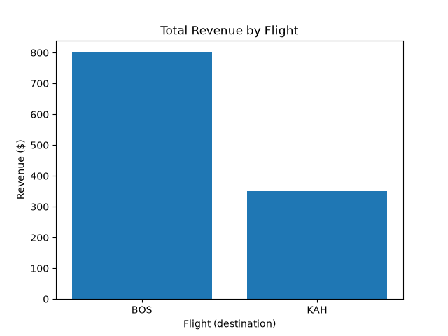
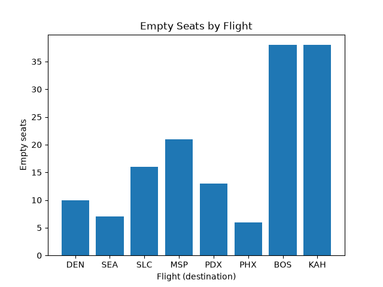

# Summit Air Flight Booking App

## Business Problem
Summit Air is a small regional airline flying out of Missoula. Every plane
holds 40 passengers: 10 first class seats and 30 economy seats. Staff track
bookings in a spreadsheet and cannot easily see how full each flight is or
how much money cancellations cost. This app lets an agent view flights, book
and cancel seats, and add new flights.

## Business Question
How many seats go empty, and how much revenue do we lose, when passengers cancel?

## How to Run
1. Open the project folder in VS Code
2. Run `main.py`
3. Choose an option from the menu

## Menu Options
1. View flights
2. Book a passenger
3. Cancel a booking (coming soon)
4. Add a new flight
5. Booking report
6. Charts
7. Save and exit

## Files
- `main.py` - runs the menu
- `flights.csv` - flight prices and booked seats
- `bookings.csv` - bookings that have been recorded
- `revenue_by_flight.png` - bar chart of revenue for each flight
- `empty_seats_by_flight.png` - bar chart of empty seats on each flight

## Charts

BOS earns the most revenue from the bookings recorded so far, which shows where our money comes from.

BOS and KAH have the most empty seats, so those flights are where we lose the most possible revenue.

## Author
Bennet Temer
